# Dossier de conception — FADAA Santé

## 1. Objet du document

Ce document présente la conception fonctionnelle et technique de FADAA Santé. Il complète le rapport de stage avec les modèles nécessaires à la compréhension du système avant et pendant sa réalisation : acteurs, cas d’utilisation, architecture, données, workflows, sécurité et déploiement.

La notation utilisée est principalement UML, représentée avec Mermaid afin que les diagrammes restent modifiables dans un fichier texte.

## 2. Périmètre du système

FADAA Santé est une plateforme SaaS multi-cabinets couvrant :

- gestion des cabinets et abonnements ;
- authentification et permissions ;
- patients, médecins et personnel ;
- rendez-vous, agenda, QR et visites ;
- honoraires, factures, paiements, RAP et échéances ;
- dépenses, achats et rapports financiers ;
- ordonnances, médicaments et documents ;
- dossiers CNSS/CNOPS ;
- notifications et WhatsApp ;
- blogs, événements et galeries ;
- support, audit et sauvegardes.

## 3. Acteurs du système

| Acteur | Responsabilité |
|---|---|
| Visiteur | Consulte la vitrine, les médecins, blogs et événements ; demande un rendez-vous ou s’inscrit à un événement |
| Patient | Consulte ses rendez-vous, QR, documents, ordonnances, paiements et dossiers CNSS/CNOPS |
| Médecin administrateur | Pilote le cabinet, les consultations, les finances, les utilisateurs et la configuration |
| Personnel | Utilise uniquement les modules autorisés par la matrice de permissions |
| Super administrateur | Administre la plateforme SaaS, les plans, cabinets, contenus publics, support et sauvegardes |
| Worker | Exécute les rappels, échéances et tâches automatiques |
| Services externes | E-mail, WhatsApp Meta, cartographie et éventuelles visioconférences |

## 4. Diagramme de contexte

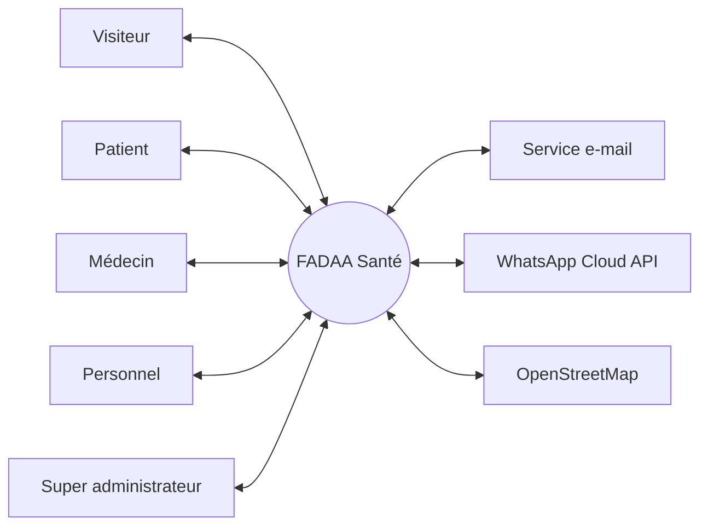

## 5. Diagramme global des cas d’utilisation

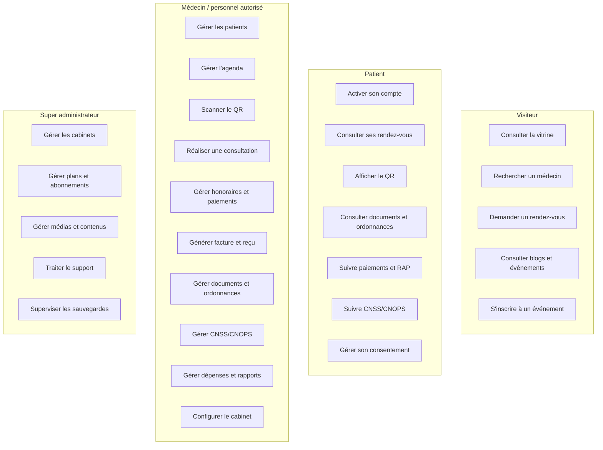

## 6. Cas d’utilisation détaillés

### 6.1 UC-RDV-01 — Créer un rendez-vous

| Élément | Description |
|---|---|
| Acteur principal | Médecin ou personnel autorisé |
| Préconditions | Utilisateur authentifié, cabinet actif, permission rendez-vous en écriture |
| Déclencheur | L’acteur choisit « Créer un rendez-vous » |
| Scénario nominal | Sélection du patient et du médecin ; choix de la date et du créneau ; saisie du motif ; validation de disponibilité ; création ; génération d’un QR unique |
| Alternatives | Créneau occupé ; médecin indisponible ; patient introuvable ; abonnement en lecture seule |
| Postconditions | Rendez-vous enregistré, historique créé, QR disponible au patient |

### 6.2 UC-RDV-02 — Confirmer la présence par QR

| Élément | Description |
|---|---|
| Acteur principal | Médecin |
| Préconditions | Rendez-vous existant, QR actif, médecin du même cabinet et affecté au rendez-vous |
| Scénario nominal | Scan ; résolution du jeton ; affichage patient/date/heure ; confirmation ; enregistrement de l’heure réelle ; passage en attente |
| Alternatives | QR inconnu ; rendez-vous annulé ; autre médecin ; demande non acceptée |
| Postconditions | Présence horodatée et historisée sans doublon |

### 6.3 UC-FIN-01 — Encaisser un paiement

| Élément | Description |
|---|---|
| Acteur principal | Médecin ou personnel financier autorisé |
| Préconditions | Honoraire existant et non annulé |
| Scénario nominal | Sélection de l’honoraire ; montant ; mode ; compte bancaire si nécessaire ; contrôle du RAP ; création du versement ; recalcul financier |
| Alternatives | Montant supérieur au RAP ; chèque incomplet ; compte bancaire obligatoire absent |
| Postconditions | Versement visible dans l’historique, RAP mis à jour, reçu disponible |

### 6.4 UC-FIN-02 — Annuler un paiement

| Élément | Description |
|---|---|
| Acteur principal | Médecin autorisé |
| Préconditions | Paiement valide et non déjà annulé |
| Scénario nominal | Confirmation ; statut `ANNULE` ; conservation du paiement ; recalcul honoraire, facture, RAP et échéance |
| Postconditions | Paiement exclu des encaissements mais toujours traçable |

### 6.5 UC-CNSS-01 — Suivre un dossier CNSS/CNOPS

| Élément | Description |
|---|---|
| Acteurs | Cabinet puis patient |
| Scénario nominal | Création ; traitement ; mise à disposition ; réception patient ; dépôt organisme ; décision ; remboursement ou rejet |
| Règle particulière | Un rejet exige un commentaire explicatif |
| Postconditions | Statut et historique visibles selon l’espace |

## 7. Architecture logique

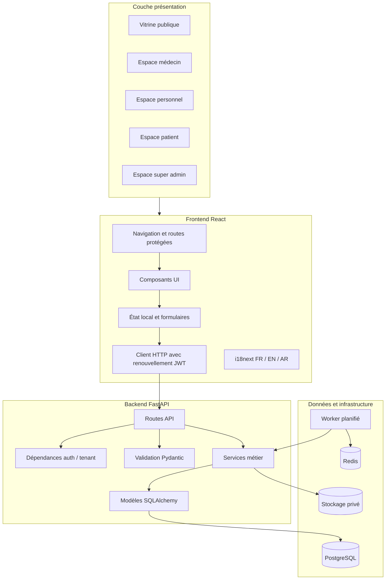

## 8. Diagramme de composants

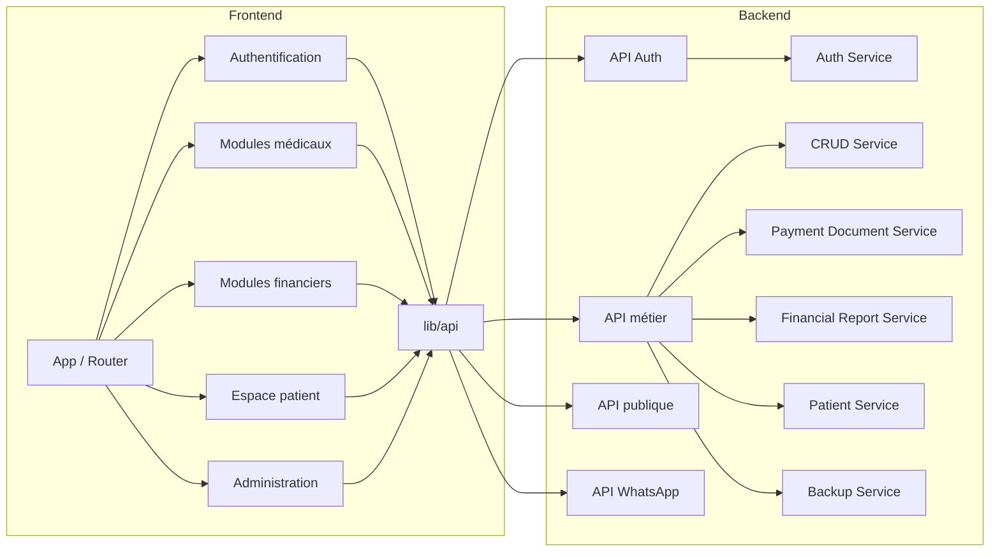

## 9. Diagramme de classes métier simplifié

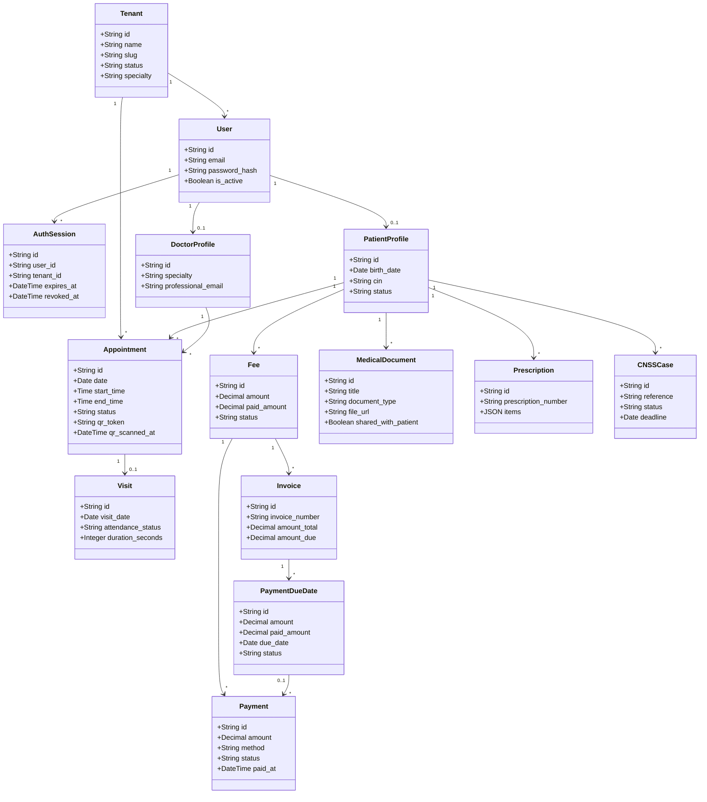

## 10. Modèle relationnel principal

| Table | Clé primaire | Clés étrangères principales | Rôle |
|---|---|---|---|
| `tenants` | `id` | — | Cabinet client SaaS |
| `users` | `id` | `tenant_id` | Identité et connexion |
| `auth_sessions` | `id` | `user_id`, `tenant_id` | Sessions par appareil |
| `patient_profiles` | `id` | `user_id`, `tenant_id` | Informations patient |
| `patient_cabinet_memberships` | `id` | `patient_id`, `tenant_id` | Patient multi-cabinets |
| `doctor_profiles` | `id` | `user_id`, `tenant_id` | Informations médecin |
| `appointments` | `id` | `tenant_id`, `patient_id`, `doctor_id` | Rendez-vous et QR |
| `visits` | `id` | `appointment_id`, patient, médecin | Consultation réalisée |
| `fees` | `id` | tenant, patient, médecin | Honoraire |
| `invoices` | `id` | `fee_id`, patient | Facture |
| `payments` | `id` | fee, invoice, échéance, patient | Versement financier |
| `payment_due_dates` | `id` | invoice, fee, patient | Échéance attendue |
| `payment_documents` | `id` | payment, fee, patient | Reçu ou facture PDF |
| `expenses` | `id` | tenant, fournisseur, compte | Sortie financière |
| `medical_documents` | `id` | tenant, patient, médecin | Document privé |
| `prescriptions` | `id` | tenant, patient, médecin | Ordonnance |
| `cnss_cases` | `id` | tenant, patient | Dossier CNSS/CNOPS |
| `operation_history` | `id` | ressources métier | Historique fonctionnel |
| `audit_logs` | `id` | tenant, utilisateur | Audit technique |

## 11. Conception du workflow rendez-vous

### 11.1 Machine à états

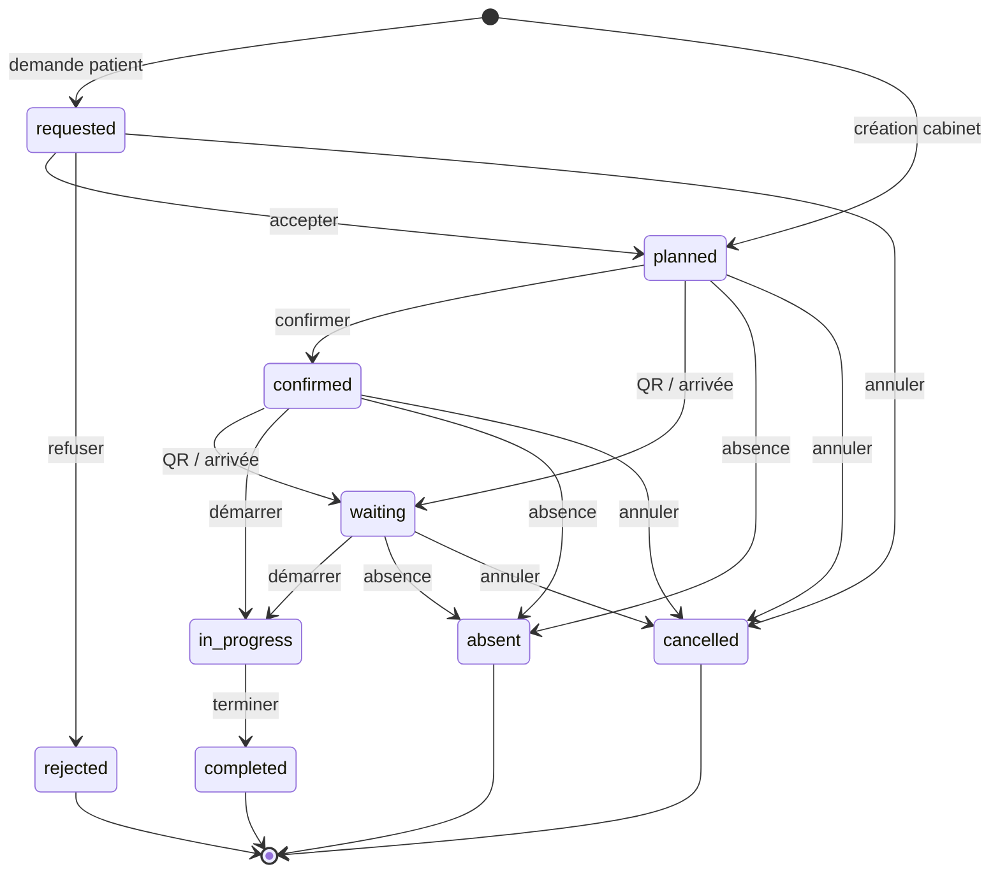

### 11.2 Séquence de création et consultation

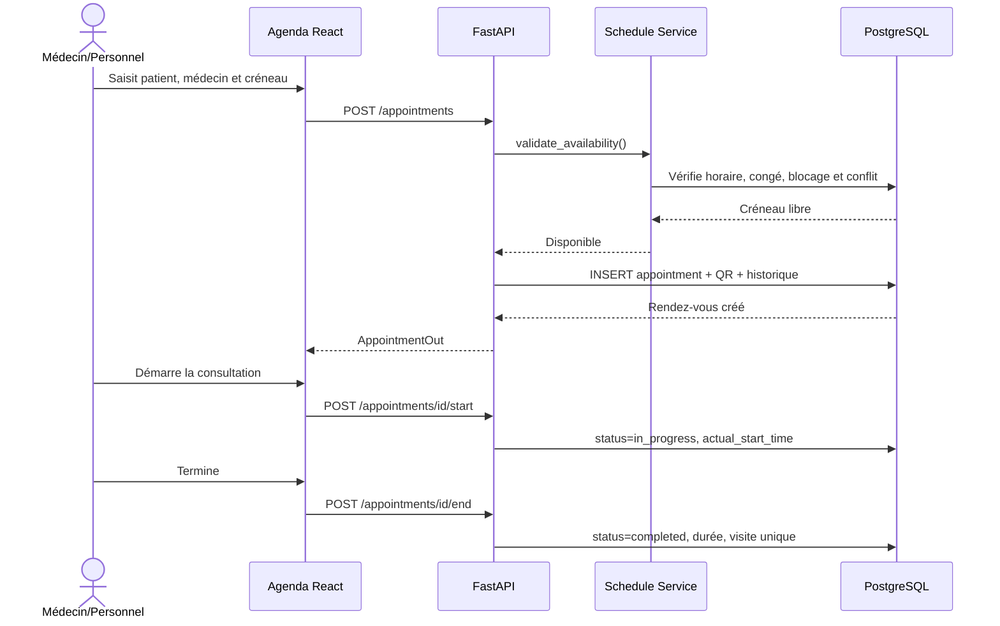

## 12. Conception du workflow financier

### 12.1 États d’un paiement

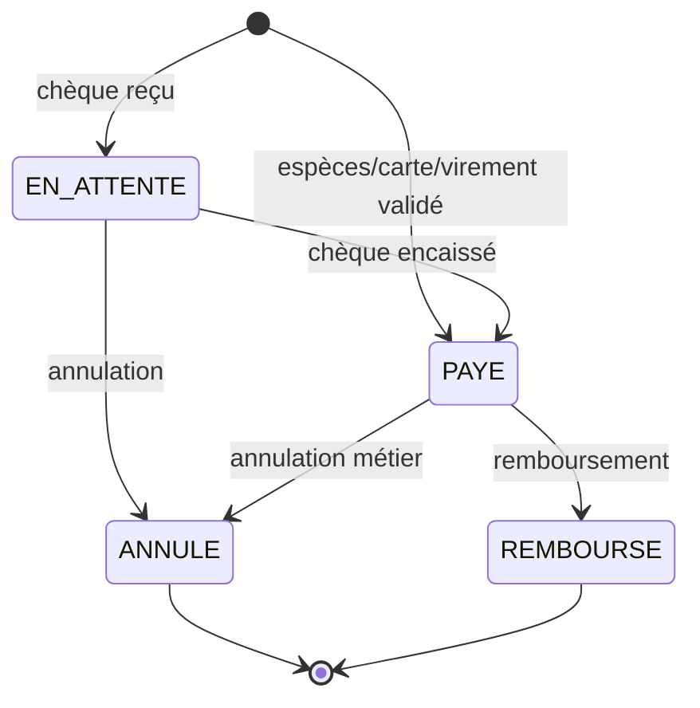

### 12.2 Calculs

```text
paiement_valide = statut non annulé/remboursé
                   ET (mode différent de chèque OU chèque encaissé)

total_paye = somme(paiements_valides.amount)
RAP = max(0, honoraire.amount - total_paye)
reste_echeance = max(0, echeance.amount - paiements_valides_de_echeance)
```

### 12.3 Séquence d’encaissement

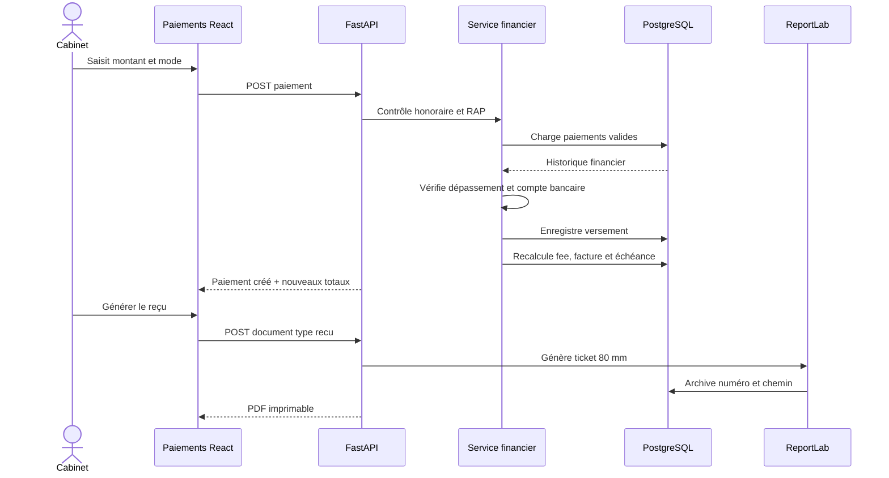

## 13. Conception du workflow CNSS/CNOPS

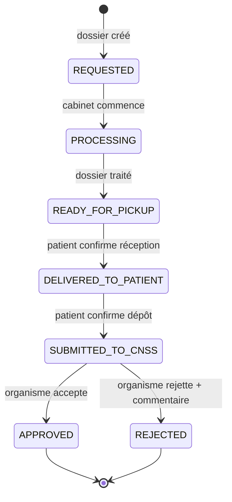

Chaque transition produit une entrée d’historique contenant le statut précédent, le nouveau statut, l’auteur, la date et éventuellement un commentaire.

## 14. Conception de la sécurité

### 14.1 Chaîne de décision d’autorisation

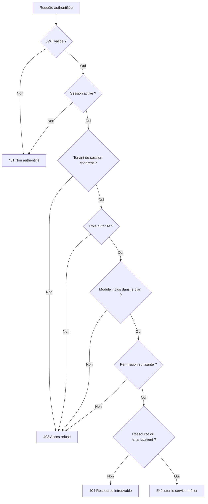

### 14.2 Matrice simplifiée

| Ressource | Médecin | Personnel | Patient | Super Admin |
|---|---|---|---|---|
| Patients du cabinet | CRUD | Selon permission | Son propre profil | Aucun contenu médical |
| Rendez-vous | CRUD | Selon permission | Ses rendez-vous | Aucun contenu médical |
| Paiements | CRUD/annulation | Selon permission | Lecture autorisée | Aucun paiement médical |
| Documents | CRUD/partage | Selon permission | Documents partagés | Aucun contenu médical |
| Configuration cabinet | Administration | Généralement aucun accès | Préférences patient | Statut plateforme seulement |
| Plans SaaS | Lecture | Aucun | Aucun | CRUD |
| Sauvegardes | Aucun | Aucun | Aucun | Administration |

## 15. Conception de la pagination

Les listes à croissance continue utilisent les paramètres :

```text
page=1
page_size=10
search=...
sort_by=created_at
sort_order=desc
```

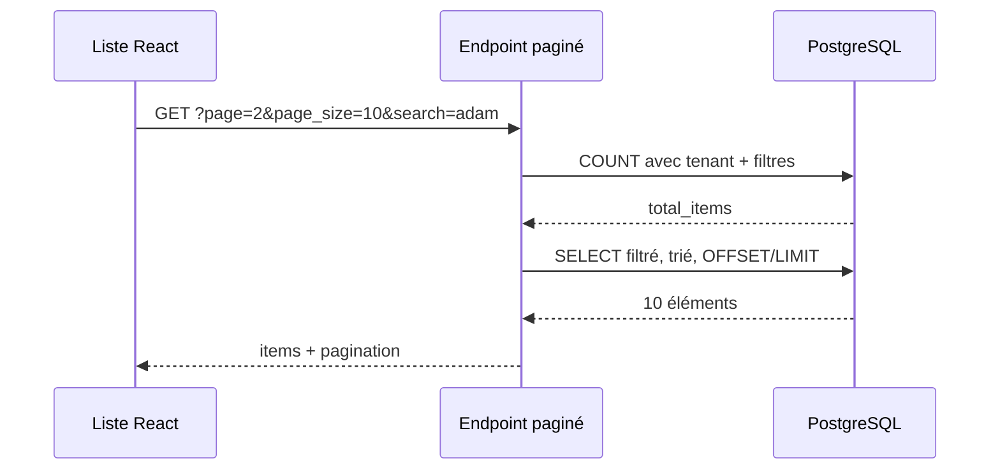

La recherche est exécutée avant `OFFSET/LIMIT`, garantissant qu’elle porte sur toutes les données autorisées.

## 16. Conception documentaire

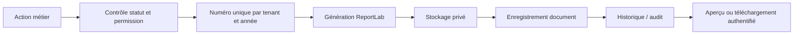

Documents générés :

- facture A4 ;
- reçu/ticket de caisse 80 mm ;
- ordonnance A4 ;
- rapport financier PDF ;
- rapport financier Excel.

## 17. Conception des interfaces

### 17.1 Principes

- une action principale clairement identifiable par écran ;
- statuts représentés par un libellé et une couleur ;
- formulaires regroupés selon le métier ;
- détails secondaires repliables ;
- listes paginées et filtrables ;
- modales fermables par bouton et clic extérieur lorsque sans risque ;
- boutons désactivés selon le statut ;
- affichage des noms, jamais des UUID comme valeur principale ;
- responsive desktop, tablette et mobile ;
- traductions FR, EN, AR et RTL.

### 17.2 Arborescence de navigation

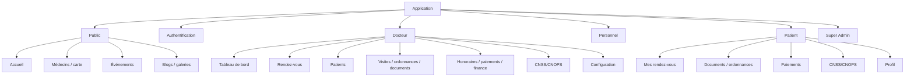

## 18. Conception du déploiement

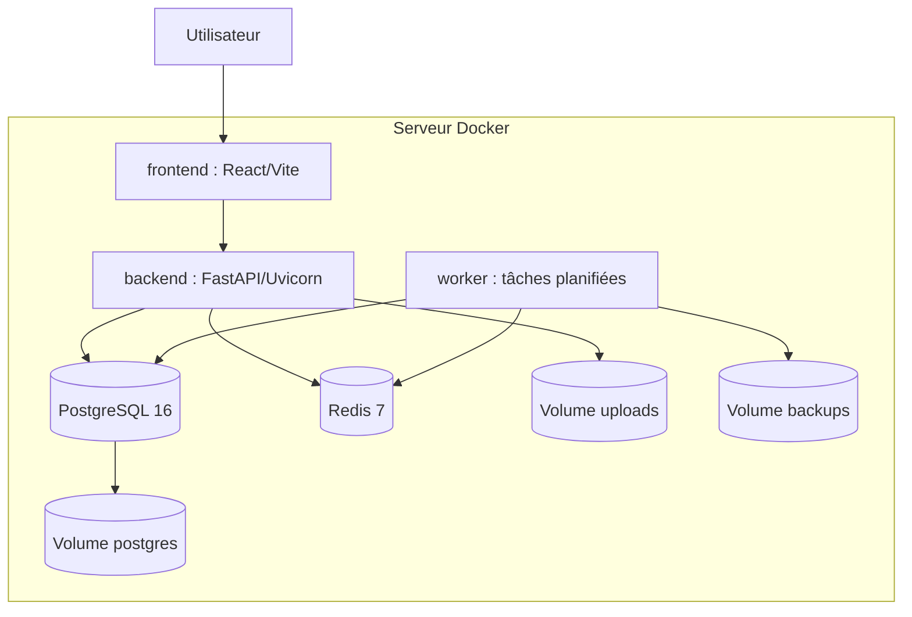

En production, un reverse proxy TLS doit être placé devant le frontend et le backend. Les secrets doivent être injectés par l’environnement et les volumes doivent être sauvegardés hors du serveur principal.

## 19. Règles métier centrales

| Code | Règle |
|---|---|
| RM-01 | Toute ressource médicale appartient à un cabinet |
| RM-02 | Un patient peut être rattaché à plusieurs cabinets |
| RM-03 | Un rendez-vous ne peut pas chevaucher un autre rendez-vous actif du même médecin |
| RM-04 | Un QR appartient à un seul rendez-vous et son scan est idempotent |
| RM-05 | Une visite liée à un rendez-vous est unique |
| RM-06 | Un paiement annulé reste visible mais est exclu des totaux |
| RM-07 | Un chèque non encaissé n’est pas une entrée de trésorerie réelle |
| RM-08 | Le montant cumulé valide ne dépasse pas le montant dû |
| RM-09 | Un reçu ne peut pas être généré pour un paiement annulé/remboursé |
| RM-10 | Un document patient n’est visible que s’il est explicitement partagé |
| RM-11 | Un rejet CNSS/CNOPS exige un commentaire |
| RM-12 | Le personnel agit selon sa permission par module |
| RM-13 | Le Super Admin n’accède pas aux données médicales |
| RM-14 | Les actions sensibles sont historisées |

## 20. Contraintes de base de données

- clés primaires UUID afin d’éviter les identifiants séquentiels exposés ;
- clés étrangères pour assurer les rattachements ;
- suppression en cascade uniquement lorsque la dépendance le justifie ;
- `SET NULL` pour préserver un historique lorsque l’acteur associé disparaît ;
- index sur `tenant_id`, dates, statuts et champs de recherche ;
- unicité du QR de rendez-vous ;
- unicité d’une visite par rendez-vous ;
- unicité des numéros de document dans le tenant ;
- montants en `NUMERIC(12,2)` ;
- migrations Alembic pour toute évolution structurelle.

## 21. Exigences de performance

- pagination côté serveur pour les listes longues ;
- index composites tenant/date/statut ;
- chargement parallèle des données indépendantes côté frontend ;
- limitation du nombre de résultats de recherche instantanée ;
- réutilisation des documents générés lorsqu’ils sont immuables ;
- worker séparé pour les rappels automatiques ;
- possibilité future de cache Redis sur les données publiques.

## 22. Exigences de qualité

| Attribut | Décision de conception |
|---|---|
| Maintenabilité | Séparation routes, services, schémas et modèles |
| Testabilité | Services métier appelables indépendamment de l’interface |
| Portabilité | Conteneurs Docker et configuration par variables |
| Sécurité | Défense en profondeur : JWT, session, rôle, tenant, permission, statut |
| Auditabilité | Journaux techniques et historiques métier |
| Extensibilité | Modules frontend/backend et schéma migrable |
| Interopérabilité | API REST/OpenAPI réutilisable par mobile |

## 23. Matrice de traçabilité des besoins

| Besoin | Composants de conception | Validation |
|---|---|---|
| Agenda médical | Appointment, Schedule, FullCalendar | Conflits et transitions testés |
| QR patient | qr_token, endpoints resolve/confirm, scanner | Unicité et second scan sans doublon |
| Paiements partiels | Payment, Fee, Invoice, DueDate | RAP recalculé |
| Reçu | PaymentDocument, ReportLab 80 mm | PDF numéroté et imprimable |
| Rapport mensuel | FinancialReportService, OpenPyXL | PDF/Excel entrées-sorties |
| Isolation cabinet | tenant_id, dépendances auth | Accès inter-tenant refusé |
| Personnel limité | StaffPermission | Boutons et API contrôlés |
| Espace patient | routes patient scoped | Données propres uniquement |
| CNSS/CNOPS | CNSSCase, historique, agenda | Transition et commentaire rejet |
| Documents privés | MedicalDocument, routes protégées | Partage patient vérifié |

## 24. Conclusion de conception

La conception de FADAA Santé repose sur trois principes directeurs : **isolation**, **traçabilité** et **cohérence métier**. L’isolation multi-tenant protège chaque cabinet. La traçabilité conserve l’historique des opérations médicales, financières et administratives. La cohérence métier est assurée par des états contrôlés, des contraintes relationnelles et des calculs réalisés côté serveur.

L’architecture en couches et l’orientation API réduisent le couplage entre l’interface et les règles métier. Cette base permet de faire évoluer la plateforme vers une application mobile, un déploiement distribué ou de nouvelles intégrations sans remettre en cause les concepts centraux.

## 25. Utilisation dans le rapport de stage

Pour le rapport final :

1. intégrer les sections 3 à 6 dans le chapitre « Analyse fonctionnelle » ;
2. intégrer les sections 7 à 10 dans le chapitre « Conception générale et détaillée » ;
3. choisir quatre diagrammes principaux dans le corps du rapport ;
4. placer les autres diagrammes en annexes ;
5. ajouter sous chaque diagramme une phrase d’interprétation ;
6. numéroter les figures : « Figure 1 », « Figure 2 », etc. ;
7. exporter les diagrammes Mermaid en PNG ou SVG avant l’intégration dans Word si l’établissement n’accepte pas Mermaid.
