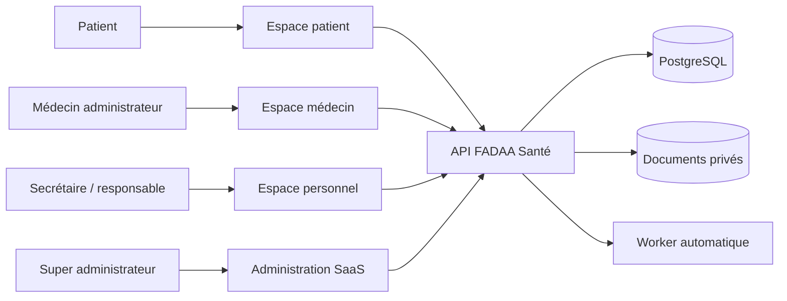
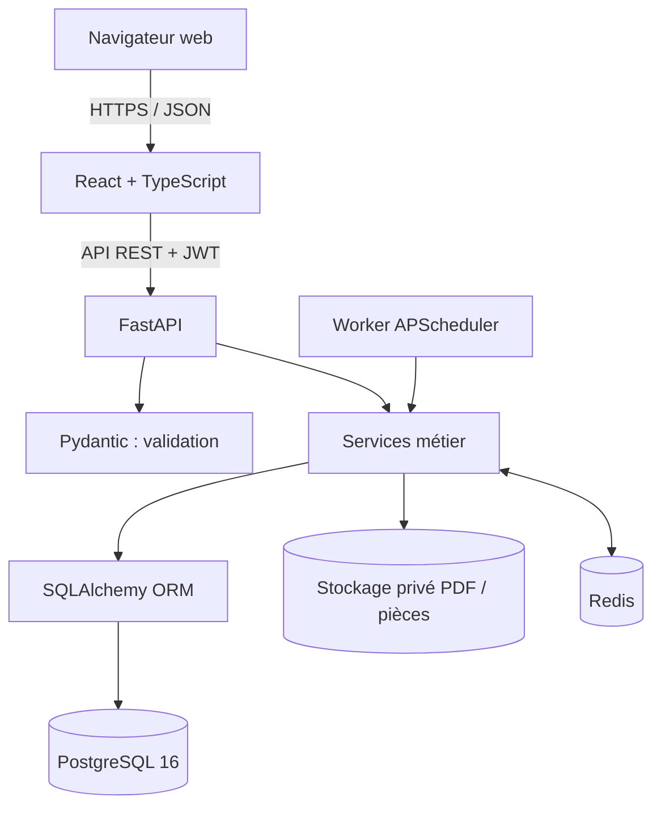
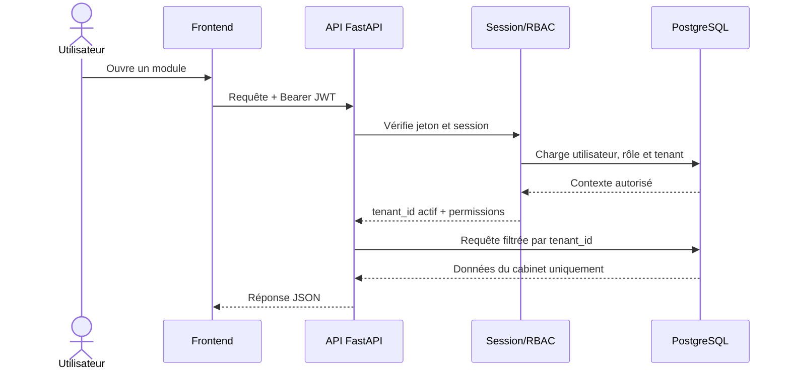
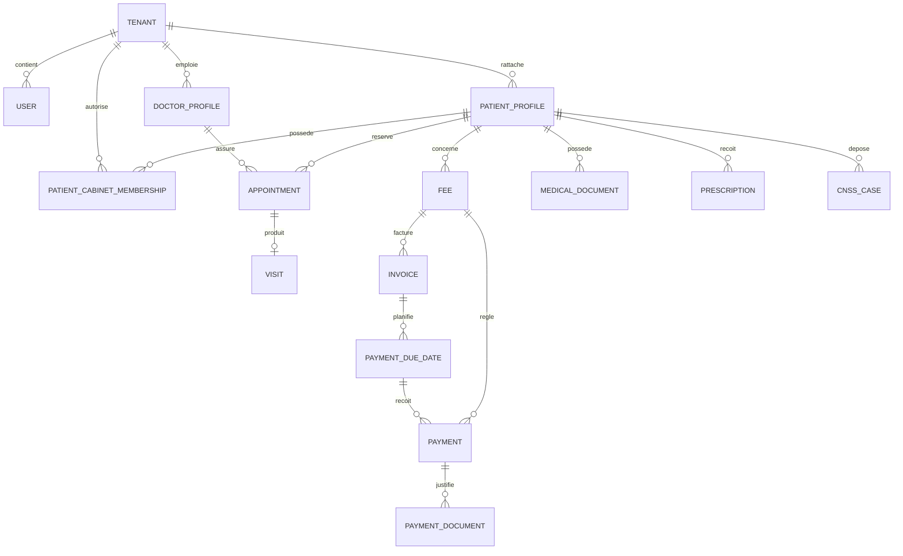
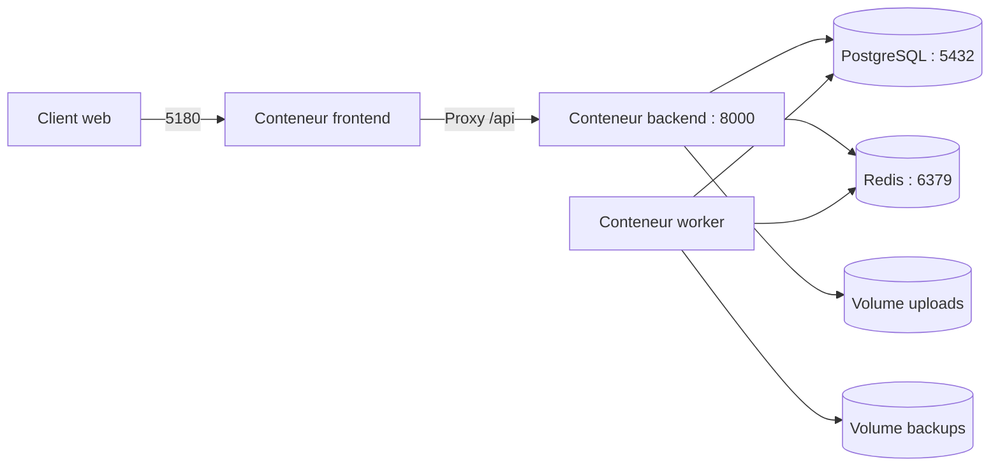
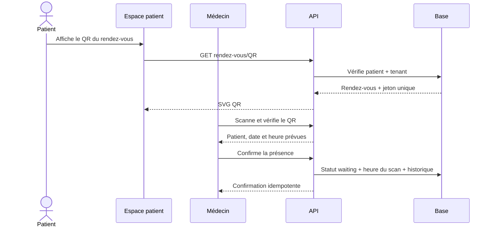
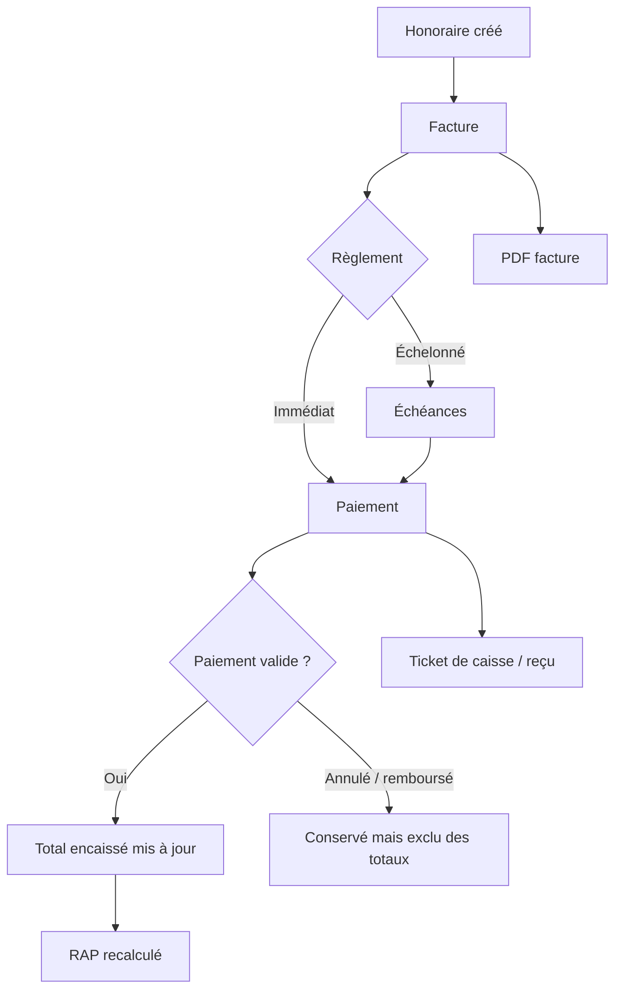

# RAPPORT DE STAGE

## Conception et développement d’une plateforme SaaS de gestion médicale multi-cabinets

### Projet : FADAA Santé

---

**Réalisé par :** [Nom et prénom du stagiaire]  
**Filière :** [Nom de la filière]  
**Établissement :** [Nom de l’établissement]  
**Entreprise d’accueil :** [Nom de l’entreprise]  
**Encadrant pédagogique :** [Nom de l’encadrant]  
**Encadrant professionnel :** [Nom de l’encadrant]  
**Période du stage :** [Date de début] – [Date de fin]  
**Année universitaire :** 2025–2026

---

> Document de conception technique et fonctionnelle préparé à partir de l’implémentation réelle du projet FADAA Santé.

## Remerciements

Je tiens à remercier l’ensemble des personnes ayant contribué au bon déroulement de ce stage. Je remercie particulièrement mon encadrant professionnel pour son accompagnement, ses conseils et sa disponibilité, ainsi que mon encadrant pédagogique pour son suivi méthodologique. Je remercie également l’équipe de l’entreprise d’accueil pour les échanges fonctionnels et techniques qui ont permis de mieux comprendre les besoins d’un cabinet médical et de proposer une solution cohérente, sécurisée et évolutive.

## Résumé

Ce rapport présente la conception et le développement de **FADAA Santé**, une plateforme web SaaS destinée à la gestion de cabinets médicaux. La solution centralise la gestion des patients, des rendez-vous, des consultations, des honoraires, des paiements, des échéances, des dépenses, des documents médicaux, des ordonnances et des dossiers CNSS/CNOPS. Elle propose également un espace patient, un espace médecin, un espace personnel et une administration générale de la plateforme.

Le principal enjeu technique du projet réside dans la mise en place d’une architecture **multi-tenant**, dans laquelle plusieurs cabinets utilisent la même application et la même infrastructure sans pouvoir accéder aux données des autres cabinets. La solution repose sur React et TypeScript pour l’interface, FastAPI pour l’API, SQLAlchemy et PostgreSQL pour les données, Alembic pour les migrations et Docker Compose pour l’orchestration. Des mécanismes de sécurité complémentaires ont été intégrés : authentification JWT, sessions révocables, contrôle des rôles, permissions par module, isolation par cabinet, traçabilité des opérations et stockage privé des documents.

Le projet adopte une architecture modulaire et orientée API afin de faciliter son évolution vers des applications mobiles et des intégrations externes. Les résultats obtenus démontrent la faisabilité d’une plateforme médicale moderne, ergonomique et adaptée à la croissance progressive d’un service SaaS.

**Mots-clés :** SaaS, santé numérique, cabinet médical, multi-tenant, FastAPI, React, PostgreSQL, sécurité, API REST, gestion médicale.

## Abstract

This report presents the design and development of **FADAA Santé**, a multi-practice medical management SaaS platform. The application centralizes patients, appointments, visits, fees, payments, installments, expenses, medical documents, prescriptions and CNSS/CNOPS insurance files. It provides dedicated workspaces for patients, doctors, staff members and platform administrators.

The main technical challenge is tenant isolation: several practices share the application infrastructure while each practice can only access its own information. The platform uses React and TypeScript for the frontend, FastAPI for the backend API, SQLAlchemy and PostgreSQL for persistence, Alembic for database migrations and Docker Compose for deployment. Security includes JWT authentication, revocable sessions, role-based access control, module permissions, tenant filtering, audit logs and private document storage.

**Keywords:** SaaS, digital health, medical practice, multi-tenancy, FastAPI, React, PostgreSQL, security, REST API.

## Table des matières proposée

1. Introduction générale  
2. Contexte et étude de l’existant  
3. Cahier des charges  
4. Analyse fonctionnelle  
5. Conception générale  
6. Conception des données  
7. Architecture technique et technologies  
8. Réalisation des modules  
9. Sécurité et protection des données  
10. Tests et validation  
11. Déploiement et exploitation  
12. Bilan, limites et perspectives  
13. Conclusion générale

---

# 1. Introduction générale

La transformation numérique du secteur de la santé concerne aussi bien les grands établissements que les cabinets médicaux. Un cabinet doit quotidiennement organiser des rendez-vous, recevoir des patients, conserver des documents, préparer des ordonnances, enregistrer des paiements et suivre des démarches administratives. Lorsque ces opérations sont réalisées au moyen de fichiers séparés, de feuilles de calcul ou de documents papier, les informations deviennent difficiles à retrouver et les risques d’erreur ou de perte augmentent.

Le projet FADAA Santé répond à cette problématique par une plateforme centralisée accessible depuis un navigateur. Le médecin dispose d’un tableau de bord métier, le personnel bénéficie de permissions adaptées, le patient accède à ses informations partagées et le super administrateur exploite la plateforme SaaS sans consulter les données médicales des cabinets.

L’objectif de ce stage était de participer à la conception et à la réalisation d’un système complet, en tenant compte simultanément des besoins fonctionnels, de l’expérience utilisateur, de l’intégrité financière, de la confidentialité des données et de l’évolutivité de l’architecture.

# 2. Contexte et étude de l’existant

## 2.1 Contexte métier

Un cabinet médical gère plusieurs catégories d’informations :

- identité et coordonnées du patient ;
- rendez-vous, horaires et absences ;
- consultations, actes et observations ;
- honoraires, factures, paiements et restes à payer ;
- échéances et garanties de paiement ;
- ordonnances et médicaments ;
- documents médicaux et administratifs ;
- dossiers de remboursement CNSS/CNOPS ;
- dépenses et achats du cabinet ;
- communications et rappels destinés aux patients.

Ces données sont fortement liées. Par exemple, un rendez-vous peut conduire à une visite, laquelle peut être associée à un honoraire, une facture, plusieurs versements et différents documents. La conception doit préserver ces relations sans dupliquer les informations.

## 2.2 Limites des méthodes classiques

Les méthodes reposant sur le papier ou des fichiers indépendants présentent plusieurs limites :

- difficulté de retrouver l’historique complet d’un patient ;
- risque de doublons et d’incohérences entre les fichiers ;
- visibilité insuffisante sur les impayés et les échéances ;
- absence de contrôle précis sur les personnes autorisées ;
- traçabilité limitée des modifications ;
- préparation manuelle des factures, reçus et ordonnances ;
- accès patient difficile et communication non centralisée ;
- sauvegardes irrégulières ou non vérifiées.

## 2.3 Solution proposée

FADAA Santé est conçue comme une plateforme SaaS multi-cabinets. Un même système héberge plusieurs cabinets, mais toutes les données métier sont rattachées à un identifiant de cabinet appelé `tenant_id`. L’utilisateur ne choisit pas librement cet identifiant dans les requêtes : il est résolu depuis sa session authentifiée.

Cette approche réduit les coûts d’exploitation, facilite les mises à jour et permet d’administrer des offres commerciales communes tout en conservant une séparation logique stricte entre les cabinets.

# 3. Cahier des charges

## 3.1 Objectif général

Concevoir et développer une plateforme web sécurisée permettant de gérer le fonctionnement quotidien de plusieurs cabinets médicaux au sein d’une architecture SaaS mutualisée.

## 3.2 Objectifs spécifiques

- centraliser le dossier administratif et médical du patient ;
- proposer un agenda professionnel et une demande de rendez-vous en ligne ;
- suivre le cycle réel d’une consultation ;
- gérer les honoraires, factures, paiements partiels, RAP et échéances ;
- générer des documents PDF professionnels et traçables ;
- permettre au patient d’accéder uniquement aux informations partagées ;
- gérer les dossiers CNSS/CNOPS avec calendrier et historique ;
- contrôler les accès du personnel par module ;
- isoler les données de chaque cabinet ;
- journaliser les opérations sensibles ;
- offrir une administration SaaS, des abonnements et des sauvegardes ;
- fournir une interface responsive, multilingue et compréhensible.

## 3.3 Exigences fonctionnelles principales

| Domaine | Exigences principales |
|---|---|
| Authentification | Connexion sécurisée, activation de compte, renouvellement et révocation de session |
| Cabinet | Configuration de l’identité, des horaires, du logo, des comptes bancaires et des préférences |
| Patients | Création, recherche, dossier détaillé, historique et rattachement multi-cabinets |
| Rendez-vous | Agenda, disponibilités, statuts, demandes en ligne, QR unique et chronométrage |
| Visites | Création depuis un rendez-vous, présence, durée réelle et historique |
| Finance | Honoraires, TVA, factures, versements, RAP, échéances, dépenses et rapports |
| Documents | Import, aperçu, téléchargement, archivage, partage patient et traçabilité |
| Ordonnances | Médicaments structurés, PDF, impression et archivage |
| CNSS/CNOPS | Workflow, documents, dates limites, agenda et rappels |
| Communication | Notifications, consentement et intégration WhatsApp |
| Administration | Cabinets, plans, abonnements, événements, blogs, médias, support et sauvegardes |

## 3.4 Exigences non fonctionnelles

- **Sécurité :** authentifier chaque requête privée et contrôler rôle, cabinet et permission.
- **Confidentialité :** ne jamais exposer les données d’un autre cabinet.
- **Intégrité :** garantir la cohérence des montants et conserver les paiements annulés dans l’historique.
- **Disponibilité :** exécuter les services dans des conteneurs redémarrables.
- **Performance :** paginer les collections volumineuses et filtrer sur le serveur.
- **Maintenabilité :** séparer modèles, schémas, services, routes et composants.
- **Évolutivité :** permettre de nouveaux modules et une future application mobile.
- **Ergonomie :** présenter des statuts lisibles, des actions explicites et des interfaces responsives.
- **Traçabilité :** conserver l’auteur, la date et la nature des opérations sensibles.

# 4. Analyse fonctionnelle

## 4.1 Acteurs

### Médecin administrateur

Le médecin administrateur pilote le cabinet. Il configure les horaires et les utilisateurs, gère les patients et les rendez-vous, réalise les consultations, prépare les documents médicaux et contrôle les opérations financières.

### Personnel du cabinet

Le personnel peut correspondre à une secrétaire ou à un responsable. Son accès dépend d’une matrice de permissions : `none`, `read`, `write` ou `admin`. Une secrétaire peut, par exemple, gérer l’agenda sans accéder à la configuration sensible du cabinet.

### Patient

Le patient consulte ses rendez-vous, visites, ordonnances, documents, paiements et dossiers CNSS/CNOPS. Il peut être lié à plusieurs cabinets. Les notes internes et les documents non partagés restent invisibles dans son espace.

### Super administrateur

Le super administrateur gère la plateforme, les plans, les abonnements, le support, les événements, les blogs, les médias et les sauvegardes. Il n’accède pas au contenu médical des patients.

## 4.2 Diagramme simplifié des acteurs



## 4.3 Parcours fonctionnel global

1. Le cabinet est créé et configuré.
2. Le médecin définit ses horaires et invite son personnel.
3. Le patient est créé par le cabinet ou effectue une demande en ligne.
4. Un rendez-vous est planifié puis confirmé.
5. Le patient présente son QR et le médecin confirme son arrivée.
6. La consultation démarre, puis se termine avec une durée réelle.
7. Un honoraire et une facture peuvent être créés.
8. Le patient règle en une ou plusieurs fois.
9. Chaque versement reste dans l’historique et un reçu peut être généré.
10. Les ordonnances, documents ou dossiers CNSS/CNOPS sont archivés et partagés selon les droits.

# 5. Conception générale

## 5.1 Architecture en couches

La plateforme utilise une architecture web client–serveur. L’interface React communique avec l’API FastAPI au moyen de requêtes HTTP JSON. Le backend applique les règles métier puis utilise SQLAlchemy pour lire ou modifier PostgreSQL.



Cette séparation présente plusieurs avantages :

- l’interface ne contient pas les règles de sécurité définitives ;
- les données entrantes sont validées avant traitement ;
- les règles métier peuvent être réutilisées par plusieurs routes ;
- l’API peut servir ultérieurement une application mobile ;
- les migrations de base sont versionnées indépendamment du frontend.

## 5.2 Architecture multi-tenant

Le modèle retenu utilise une base partagée et une colonne `tenant_id` sur les ressources appartenant à un cabinet. Les tables globales, comme les plans SaaS, ne dépendent pas nécessairement d’un tenant.

À chaque requête authentifiée :

1. le backend décode le jeton JWT ;
2. il retrouve la session active ;
3. il vérifie l’utilisateur et le cabinet autorisé ;
4. il place le cabinet actif dans le contexte utilisateur ;
5. les services ajoutent une condition `tenant_id = cabinet_actif` ;
6. les permissions du rôle et du module sont contrôlées.



## 5.3 Conception modulaire

Le backend distingue :

- `models` : tables SQLAlchemy et relations ;
- `schemas` : objets Pydantic d’entrée et de sortie ;
- `services` : règles métier, calculs et génération documentaire ;
- `api` : routes HTTP et dépendances d’authentification ;
- `workers` : traitements planifiés ;
- `core` : configuration, sécurité, base de données et contexte tenant.

Le frontend distingue :

- les espaces `admin`, `dashboard`, `patient`, `staff` et `public` ;
- les composants réutilisables ;
- la couche d’accès API ;
- l’authentification locale ;
- les traductions et les styles globaux.

# 6. Conception des données

## 6.1 Entités principales

Le modèle relationnel contient notamment les groupes suivants :

- **identité et accès :** `users`, `roles`, `user_roles`, `auth_sessions`, `staff_permissions` ;
- **cabinet :** `tenants`, paramètres, horaires, indisponibilités et créneaux bloqués ;
- **patient :** profil patient et rattachements à plusieurs cabinets ;
- **soins :** rendez-vous, visites, ordonnances et médicaments ;
- **finance :** honoraires, factures, paiements, échéances, reçus, comptes bancaires et dépenses ;
- **documents :** catégories et documents médicaux ;
- **assurance :** dossiers CNSS/CNOPS et historique des statuts ;
- **communication :** notifications, conversations et consentements WhatsApp ;
- **plateforme :** abonnements, plans, support, événements, blogs, médias et sauvegardes.

## 6.2 Diagramme entité–relation simplifié



## 6.3 Intégrité financière

Les montants sont stockés au format décimal afin d’éviter les erreurs d’arrondi des nombres flottants. Les calculs importants sont effectués côté serveur.

Les règles principales sont :

```text
Paiements encaissés = somme des paiements valides et réellement encaissés
RAP = montant total de l’honoraire − paiements valides
Solde mensuel = entrées encaissées − dépenses du mois
```

Un paiement annulé n’est pas supprimé. Son statut devient `ANNULE`, il reste visible dans l’historique et ne participe plus aux totaux. Pour un chèque, le montant ne devient encaissé qu’après le statut d’encaissement approprié.

## 6.4 Versionnement de la base

Alembic permet de conserver une suite de migrations reproductibles. Chaque modification structurelle est représentée par une révision disposant d’une opération `upgrade` et, lorsque cela est possible, d’une opération `downgrade`. Au démarrage du backend Docker, la commande `alembic upgrade head` applique les migrations manquantes.

# 7. Architecture technique et technologies

## 7.1 Frontend

| Technologie | Utilisation |
|---|---|
| React 19 | Construction des écrans et composants interactifs |
| TypeScript 5 | Typage des données et détection d’erreurs avant exécution |
| Vite 6 | Serveur de développement et build de production |
| Tailwind CSS 3 | Mise en forme responsive et design system |
| FullCalendar 6 | Agendas rendez-vous et CNSS/CNOPS |
| i18next | Traductions français, anglais et arabe, avec RTL |
| Leaflet / React-Leaflet | Cartographie des cabinets avec OpenStreetMap |
| Framer Motion | Animations et transitions maîtrisées |
| Lucide React | Icônes cohérentes et accessibles |

Le frontend gère la présentation, les formulaires et l’état de navigation. Les actions sensibles restent vérifiées côté backend, même lorsqu’elles sont masquées ou désactivées dans l’interface.

## 7.2 Backend

| Technologie | Utilisation |
|---|---|
| Python 3 | Langage principal du serveur |
| FastAPI | API REST, injection de dépendances et documentation OpenAPI |
| Pydantic | Validation et sérialisation des requêtes/réponses |
| SQLAlchemy 2 | Mapping objet-relationnel et requêtes SQL |
| PostgreSQL 16 | Base relationnelle transactionnelle |
| Alembic | Migrations versionnées |
| python-jose | Création et validation des JWT |
| Passlib / bcrypt | Hachage sécurisé des mots de passe |
| ReportLab | Factures, reçus, ordonnances et rapports PDF |
| OpenPyXL | Rapports financiers Excel |
| QRCode | QR unique par rendez-vous |
| APScheduler | Planification de rappels et tâches de cycle de vie |
| python-multipart | Import sécurisé de fichiers |

## 7.3 Infrastructure

Docker Compose orchestre cinq services :

- `frontend` : interface React exposée sur le port local `5180` ;
- `backend` : API FastAPI exposée sur `8001` ;
- `worker` : exécution des tâches automatiques ;
- `postgres` : données relationnelles ;
- `redis` : infrastructure de cache et de traitements asynchrones.

Des volumes Docker persistants conservent la base, les fichiers importés et les sauvegardes.



# 8. Réalisation des modules

## 8.1 Authentification et sessions

L’authentification délivre un jeton d’accès de courte durée et un jeton de renouvellement. Les sessions sont enregistrées indépendamment par appareil. Une session peut être révoquée sans nécessairement déconnecter tous les autres appareils. Lors de chaque requête privée, le serveur vérifie le jeton, le type de jeton, la session active, l’utilisateur et le cabinet.

Les comptes du personnel et des patients peuvent être activés à l’aide d’une invitation. Le mot de passe n’est jamais stocké en clair ; seul son hachage bcrypt est conservé.

## 8.2 Gestion des patients

La fiche patient rassemble :

- identité, coordonnées et CIN selon la configuration ;
- rendez-vous et visites ;
- honoraires, factures, paiements et RAP ;
- échéances et garanties ;
- ordonnances et documents ;
- dossiers CNSS/CNOPS ;
- activités et historique.

Les identifiants techniques restent utilisés par l’API, mais l’interface affiche les noms lisibles du patient et du médecin.

## 8.3 Rendez-vous et agenda

Le module agenda prend en compte les jours travaillés, les horaires, les pauses, les indisponibilités, les créneaux bloqués et la durée habituelle d’une consultation. Il propose des vues agenda et liste, une recherche, des filtres et des statuts métier.

Chaque rendez-vous dispose d’un QR aléatoire unique. Le patient l’affiche depuis son espace. Le médecin le scanne, vérifie le patient, la date et l’heure, puis confirme la présence. Le premier scan est horodaté ; les scans suivants ne créent pas de doublon.



Le médecin peut ensuite démarrer la consultation. L’heure réelle de début est enregistrée. À la fin, la durée est calculée et une visite liée est créée sans duplication.

## 8.4 Honoraires, factures et paiements

Un honoraire représente une prestation facturable. Il peut être rattaché à un rendez-vous ou une visite. La facture matérialise la somme due et une ou plusieurs échéances peuvent organiser le règlement.

Le système prend en charge :

- espèces, carte, virement et chèque ;
- paiements immédiats ou échelonnés ;
- plusieurs versements pour un même honoraire ;
- comptes bancaires du cabinet ;
- détails et justificatifs de chèque ;
- annulation traçable sans suppression ;
- recalcul automatique du payé et du RAP ;
- génération de facture et de reçu.

Le reçu est présenté comme un **ticket de caisse PDF de 80 mm**. Il contient le cabinet, le médecin, le patient, le montant reçu, le mode, la référence, l’acte, le total payé et le reste à payer. Il est numéroté et conservé avec le paiement.



## 8.5 Échéances et garanties

Une échéance représente un montant attendu à une date. Elle peut être simple, garantie par un tiers ou garantie par un chèque. Les données de garantie peuvent inclure le nom, la CIN, les informations du chèque et les documents importés. Une échéance peut recevoir plusieurs paiements partiels jusqu’à son règlement complet.

## 8.6 Finance et dépenses

Le module financier regroupe encaissements, créances, échéances, dépenses fixes ou variables et achats fournisseurs. Une dépense peut être liée à un compte bancaire du cabinet et détaillée en plusieurs produits avec quantité, unité, prix HT, TVA et total TTC.

Le rapport mensuel du cabinet est exportable en PDF et Excel. Il distingue :

- entrées réellement encaissées ;
- sorties et dépenses ;
- solde net ;
- détail des tiers, modes, comptes et références ;
- paiements annulés ou remboursés exclus ;
- chèques non encaissés exclus des entrées.

## 8.7 Ordonnances et médicaments

Les ordonnances utilisent une structure de médicaments et d’instructions. Le médecin peut sélectionner un médicament depuis un catalogue ou saisir un médicament personnalisé. L’architecture du catalogue permet d’ajouter ultérieurement des bases adaptées aux spécialités telles que la pédiatrie ou la cardiologie.

Chaque version importante peut produire un PDF professionnel avec l’identité du cabinet et du patient. Le document est archivé dans le dossier patient et peut être partagé selon les autorisations.

## 8.8 Documents médicaux

Le module documentaire prend en charge l’import, l’aperçu, le téléchargement, les catégories, l’archivage et le partage. Les fichiers ne sont pas servis comme un dossier public : le téléchargement passe par une route authentifiée qui vérifie le cabinet, le patient et les droits.

## 8.9 CNSS/CNOPS

Le dossier CNSS/CNOPS possède un workflow différent entre le cabinet et le patient. Le cabinet prépare et marque le dossier comme traité. Le patient confirme sa réception, son dépôt et la décision de l’organisme. En cas de rejet, un commentaire est exigé pour conserver le motif.

Les vues liste et agenda permettent de visualiser les dates limites. Un paramètre du profil patient détermine le délai de rappel avant dépôt.

## 8.10 Communication WhatsApp

L’intégration WhatsApp prévoit une configuration par cabinet, des modèles, des conversations et des journaux de messages. Le consentement du patient est explicite et historisé. Le retrait du consentement bloque les communications concernées. Les rappels peuvent porter sur un rendez-vous, un impayé ou une démarche administrative.

## 8.11 Événements, blogs et galerie

Le super administrateur peut créer des événements publics, préciser une localisation physique ou un lien en ligne, choisir l’audience et gérer les inscriptions de plusieurs participants. Les événements et blogs disposent de pages publiques et de galeries alimentées par une bibliothèque de médias.

## 8.12 Cartographie

Leaflet et OpenStreetMap affichent les médecins et cabinets disposant d’une localisation exploitable. L’utilisateur peut survoler ou sélectionner un marqueur pour consulter les informations, puis ouvrir la fiche correspondante. La carte est intégrée sans dépendre d’une clé Google Maps pour son rendu principal.

## 8.13 Administration SaaS

L’administration couvre :

- création et suivi des cabinets ;
- plans et modules d’abonnement ;
- statut d’essai, actif, délai de grâce ou suspension ;
- validation des paiements d’abonnement ;
- support et réponses ;
- événements, blogs et bibliothèque média ;
- sauvegardes et journaux techniques.

Le contrôle des modules existe dans le frontend pour l’ergonomie et dans le backend pour la sécurité.

# 9. Sécurité et protection des données

## 9.1 Authentification

- mots de passe hachés avec bcrypt ;
- JWT signés et limités dans le temps ;
- distinction entre jeton d’accès et jeton de renouvellement ;
- sessions enregistrées et révocables ;
- vérification de l’appareil/session lors des requêtes ;
- refus des comptes désactivés ou non activés.

## 9.2 Autorisation

L’autorisation combine plusieurs niveaux :

1. rôle global de l’utilisateur ;
2. cabinet actif ;
3. module inclus dans l’abonnement ;
4. niveau de permission du personnel ;
5. propriété de la ressource demandée ;
6. règles métier liées au statut.

Masquer un bouton dans React ne constitue jamais la seule protection. Le backend vérifie à nouveau l’autorisation.

## 9.3 Isolation des cabinets

Toutes les requêtes métier doivent inclure le cabinet actif. Les identifiants reçus depuis le client sont toujours comparés au `tenant_id` de la session. Un utilisateur ne peut pas utiliser l’UUID d’une ressource appartenant à un autre cabinet pour la lire ou la modifier.

## 9.4 Traçabilité

Les historiques et journaux enregistrent notamment :

- créations et modifications de rendez-vous ;
- arrivée, début et fin de consultation ;
- création et annulation de paiement ;
- génération de documents ;
- changements CNSS/CNOPS ;
- accès et téléchargements documentaires ;
- opérations administratives sensibles.

## 9.5 Téléversement de fichiers

Le serveur contrôle le type, l’extension, la signature lorsque disponible et la taille des fichiers. Les noms générés empêchent les collisions. Le stockage se trouve dans un volume privé et les téléchargements sont autorisés par une route sécurisée.

## 9.6 Limites de conformité

La plateforme applique des principes de sécurité et de minimisation adaptés aux données sensibles. Cependant, une mise en production médicale nécessite également une analyse juridique, une politique de conservation, des procédures organisationnelles, une gestion des incidents, un hébergement conforme aux exigences locales et un audit de sécurité indépendant. L’implémentation technique ne doit pas être présentée comme une certification réglementaire automatique.

# 10. Expérience utilisateur et accessibilité

L’interface utilise un design system médical cohérent : vert/bleu pour les actions principales, couleurs sémantiques pour les statuts, cartes aux coins arrondis, tableaux structurés et modales centrées.

Les choix UX principaux sont :

- informations importantes visibles avant les actions secondaires ;
- noms lisibles à la place des UUID ;
- confirmation avant annulation ou suppression ;
- badges de statut explicites ;
- boutons désactivés lorsque l’action est impossible ;
- détails repliables pour conserver des listes compactes ;
- vues liste et agenda selon le besoin ;
- responsive design pour ordinateur, tablette et mobile ;
- navigation clavier et attributs ARIA sur les dialogues importants ;
- français, anglais et arabe avec prise en charge du sens RTL.

# 11. API et échanges

## 11.1 Style REST

L’API expose des ressources HTTP sous le préfixe `/api`. Les routes utilisent principalement :

- `GET` pour consulter ;
- `POST` pour créer ou déclencher une action ;
- `PUT` pour remplacer/modifier un objet ;
- `PATCH` pour une modification partielle ;
- `DELETE` pour désactiver, annuler ou supprimer selon la règle métier.

## 11.2 Exemple conceptuel de requête authentifiée

```http
GET /api/appointments?page=1&page_size=10&sort_by=date&sort_order=desc
Authorization: Bearer <access_token>
```

Réponse paginée :

```json
{
  "items": [],
  "pagination": {
    "page": 1,
    "page_size": 10,
    "total_items": 0,
    "total_pages": 1,
    "has_next": false,
    "has_previous": false
  }
}
```

La recherche et les filtres sont appliqués côté serveur sur le jeu complet, et non uniquement sur les éléments visibles dans le navigateur.

## 11.3 Documentation

FastAPI produit automatiquement :

- Swagger UI : `http://localhost:8001/docs` ;
- ReDoc : `http://localhost:8001/redoc` ;
- schéma OpenAPI JSON ;
- validation normalisée des paramètres et corps de requête.

# 12. Tests et validation

## 12.1 Stratégie appliquée

La validation actuelle combine :

- compilation Python des modules backend ;
- typecheck et build Vite du frontend ;
- application des migrations Alembic ;
- contrôle de santé de l’API ;
- tests manuels des workflows métier ;
- vérification des réponses HTTP et des permissions ;
- contrôle des journaux Docker ;
- vérification de génération des PDF, QR et exports.

## 12.2 Cas de test fonctionnels représentatifs

| Cas | Résultat attendu |
|---|---|
| Connexion valide | Création d’une session et accès à l’espace du rôle |
| Accès inter-cabinet | Réponse refusée ou ressource introuvable |
| Créneau déjà occupé | Refus avec conflit, sans double rendez-vous |
| Scan QR valide | Patient identifié, heure enregistrée, statut mis à jour |
| Second scan du même QR | Confirmation idempotente, aucune visite en double |
| Paiement partiel | Historique conservé et RAP réduit du montant valide |
| Annulation de paiement | Statut annulé, paiement visible, totaux recalculés |
| Reçu d’un paiement annulé | Génération refusée |
| Chèque non encaissé | Exclu des encaissements réels |
| Document non partagé | Invisible dans l’espace patient |
| Rejet CNSS/CNOPS | Commentaire obligatoire et historique conservé |
| Rapport mensuel | Entrées, sorties et solde cohérents dans PDF et Excel |

## 12.3 Critères d’acceptation

- aucune ressource métier n’est renvoyée sans contrôle du cabinet ;
- les formulaires empêchent les données invalides principales ;
- les actions sensibles produisent un historique ;
- les totaux financiers sont calculés côté backend ;
- les documents générés contiennent des informations lisibles ;
- l’application se construit sans erreur TypeScript ;
- la base peut être migrée jusqu’à la dernière révision ;
- les services Docker démarrent et répondent sur leurs ports prévus.

## 12.4 Recommandations de tests futurs

- ajouter une suite Pytest pour les services financiers et les transitions d’état ;
- automatiser des tests d’intégration API avec une base temporaire ;
- ajouter Playwright pour les parcours critiques du navigateur ;
- intégrer les builds, tests et migrations à une CI ;
- réaliser des tests de charge sur les listes et documents ;
- réaliser des tests de sécurité OWASP et un audit externe.

# 13. Déploiement et exploitation

## 13.1 Démarrage local

```bash
docker compose up -d --build
```

Services locaux :

```text
Frontend : http://localhost:5180
Backend  : http://localhost:8001
Swagger  : http://localhost:8001/docs
Postgres : localhost:5432
Redis    : localhost:6379
```

## 13.2 Commandes de diagnostic

```bash
docker compose ps
docker compose logs --tail=200 backend worker
curl http://localhost:8001/api/health
docker compose exec -T backend alembic current
```

## 13.3 Build frontend

```bash
cd frontend
npm install
npm run typecheck
npm run build
```

## 13.4 Sauvegarde

La stratégie prévoit la sauvegarde de PostgreSQL et des volumes documentaires, un checksum, une durée de rétention et des tests de restauration. Une sauvegarde n’est considérée fiable que si sa restauration est régulièrement vérifiée.

Pour une production, les archives doivent être chiffrées, copiées hors du serveur principal et protégées par des droits distincts.

# 14. Méthodologie de réalisation

Le développement a suivi une démarche itérative proche de l’agilité :

1. recueil d’un besoin métier précis ;
2. analyse du modèle et des règles déjà présentes ;
3. conception du workflow et des statuts ;
4. évolution de la base par migration ;
5. développement du service backend ;
6. exposition de l’API ;
7. intégration dans l’interface ;
8. compilation et tests ;
9. correction à partir du retour utilisateur ;
10. documentation.

Cette méthode s’est révélée adaptée à un projet comprenant de nombreux modules dépendants. Elle permet de livrer progressivement tout en conservant la cohérence avec les fonctionnalités déjà existantes.

# 15. Difficultés rencontrées et solutions

## 15.1 Cohérence des statuts

Les rendez-vous, paiements, échéances et dossiers CNSS/CNOPS possèdent chacun leur propre cycle. Une transition libre aurait créé des incohérences. La solution consiste à définir des transitions autorisées côté serveur et à n’afficher dans l’interface que les actions possibles.

## 15.2 Paiements partiels et annulations

Un simple total stocké devient incorrect lorsqu’un paiement est annulé. Les paiements sont donc conservés avec leur statut et les totaux utilisent uniquement les paiements valides. Le RAP et les échéances sont recalculés à partir des opérations réelles.

## 15.3 Isolation multi-cabinets

Le risque principal est l’utilisation d’un identifiant d’un autre cabinet. La solution associe chaque ressource au tenant et centralise les recherches scoping par cabinet. Les rôles et permissions sont ensuite appliqués sur la ressource déjà filtrée.

## 15.4 Interfaces volumineuses

Les modules financiers ou patients peuvent contenir de nombreuses opérations. Des vues résumées, des détails repliables, une pagination côté serveur et des filtres permettent de réduire la surcharge visuelle.

## 15.5 Documents professionnels

Les factures, ordonnances et reçus doivent rester identifiables et reproductibles. La génération côté serveur avec ReportLab garantit une mise en page maîtrisée et un numéro de document lié à l’historique.

# 16. Bilan du stage

Ce projet a permis de mettre en pratique plusieurs compétences :

- analyse de besoins métier complexes ;
- modélisation relationnelle ;
- conception d’API REST sécurisées ;
- développement frontend avec React et TypeScript ;
- développement backend avec FastAPI et SQLAlchemy ;
- gestion de migrations PostgreSQL ;
- conception multi-tenant et RBAC ;
- génération de documents PDF et Excel ;
- conteneurisation avec Docker ;
- tests, diagnostic et lecture de journaux ;
- amélioration continue de l’UX/UI.

Au-delà de la réalisation technique, le stage a montré l’importance de la cohérence des workflows et de la traçabilité dans un système contenant des données médicales et financières.

# 17. Limites actuelles

Les limites suivantes doivent être considérées de manière transparente :

- la couverture de tests automatisés doit être renforcée ;
- le déploiement présenté repose principalement sur Docker Compose local ;
- la supervision de production doit être complétée par des métriques et alertes ;
- le stockage documentaire peut évoluer vers un service objet chiffré ;
- une validation réglementaire dépend du pays et de l’hébergement retenu ;
- les intégrations externes réelles nécessitent des identifiants, contrats et environnements partenaires ;
- les performances doivent être validées avec un volume représentatif de cabinets et de documents.

# 18. Perspectives d’évolution

- application mobile patient et médecin basée sur la même API ;
- catalogue de médicaments par spécialité et sources de référence ;
- rappels avancés et automatisations configurables ;
- signature électronique de documents ;
- téléconsultation et liens de visioconférence ;
- paiement en ligne et rapprochement bancaire ;
- tableaux de bord analytiques anonymisés ;
- export comptable ;
- recherche documentaire avancée ;
- stockage objet compatible S3 avec chiffrement ;
- haute disponibilité et déploiement Kubernetes si le volume le justifie ;
- pipeline CI/CD avec tests automatiques et contrôle de sécurité ;
- observabilité centralisée des erreurs, performances et tâches planifiées.

# 19. Conclusion générale

FADAA Santé constitue une réponse complète au besoin de centralisation d’un cabinet médical. Le projet ne se limite pas à un agenda : il relie le parcours patient, la consultation, les documents, les opérations financières, les remboursements et la communication.

La conception multi-tenant permet à plusieurs cabinets de partager la plateforme sans partager leurs données. L’architecture React, FastAPI, PostgreSQL et Docker offre une base moderne, documentée et évolutive. Les contrôles de session, de rôles, de permissions et de tenant renforcent la protection des informations sensibles, tandis que les historiques assurent la traçabilité.

Les objectifs principaux du stage ont ainsi été atteints : analyser un domaine complexe, proposer une architecture cohérente, développer des workflows métier complets et préparer la solution à de futures évolutions. Les prochaines étapes consistent principalement à industrialiser les tests, le déploiement, l’observabilité et la conformité de production.

---

# Annexes

## Annexe A — Structure simplifiée du dépôt

```text
fadaa-sante/
├── backend/
│   ├── alembic/versions/       # migrations PostgreSQL
│   ├── app/api/                # routes FastAPI
│   ├── app/core/               # sécurité, configuration, base, tenant
│   ├── app/models/             # modèles SQLAlchemy
│   ├── app/schemas/            # schémas Pydantic
│   ├── app/services/           # logique métier et documents
│   └── app/workers/            # tâches automatiques
├── frontend/
│   ├── src/components/         # composants réutilisables
│   ├── src/features/admin/     # super administration
│   ├── src/features/dashboard/ # espace médecin
│   ├── src/features/patient/   # espace patient
│   ├── src/features/staff/     # espace personnel
│   ├── src/features/public/    # vitrine, événements et blogs
│   ├── src/i18n/               # traductions
│   └── src/lib/                # API et authentification
├── docs/                       # documentation
└── docker-compose.yml
```

## Annexe B — Principales variables de configuration

Les secrets réels ne doivent jamais être copiés dans le rapport ni versionnés. Les catégories attendues comprennent :

```text
DATABASE_URL
JWT_SECRET_KEY
ACCESS_TOKEN_EXPIRE_MINUTES
REFRESH_TOKEN_EXPIRE_DAYS
FRONTEND_ORIGIN
UPLOAD_DIR
BACKUP_DIR
SMTP_* / paramètres d’envoi d’e-mail
WHATSAPP_* / paramètres Meta selon l’environnement
```

## Annexe C — Glossaire

| Terme | Définition |
|---|---|
| API | Interface permettant à deux logiciels d’échanger des données |
| JWT | Jeton signé utilisé pour représenter une authentification |
| SaaS | Logiciel fourni comme un service commun à plusieurs clients |
| Tenant | Organisation cliente isolée, ici un cabinet médical |
| Multi-tenant | Architecture hébergeant plusieurs organisations isolées |
| RBAC | Contrôle d’accès fondé sur les rôles |
| ORM | Couche reliant des objets applicatifs à des tables relationnelles |
| Migration | Modification versionnée du schéma de base de données |
| RAP | Reste à payer après déduction des paiements valides |
| CNSS/CNOPS | Organismes et workflows de couverture/remboursement santé |
| Idempotence | Propriété garantissant qu’une action répétée ne crée pas de doublon |
| OpenAPI | Description standardisée d’une API HTTP |
| RTL | Affichage de droite à gauche, notamment pour l’arabe |

## Annexe D — Documents techniques associés

- `docs/api-reference.md` : référence API ;
- `docs/openapi.json` : schéma OpenAPI ;
- `docs/multi-tenancy.md` : architecture d’isolation ;
- `docs/backup-restore.md` : stratégie de sauvegarde ;
- `docs/design-tokens.md` : règles visuelles ;
- `docs/routes-frontend.md` : routes de l’interface ;
- `docs/medication-catalog.md` : fondation du catalogue médicament ;
- `docs/mobile-api.md` : éléments d’API mobile.

## Annexe E — Personnalisation avant remise

Avant de remettre le rapport :

1. remplacer tous les champs entre crochets de la page de garde ;
2. ajouter une présentation réelle de l’entreprise d’accueil ;
3. préciser les dates, la mission personnelle et l’organisation du stage ;
4. insérer des captures d’écran dans les sections correspondantes ;
5. adapter les remerciements à l’encadrement réel ;
6. générer une table des matières automatique dans Word ou LibreOffice ;
7. appliquer les consignes de mise en page de l’établissement ;
8. relire les informations confidentielles avant diffusion.
